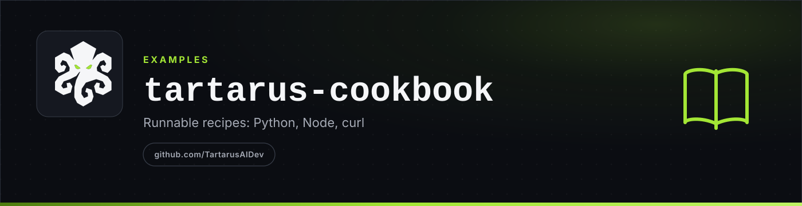

<p align="center">
  <a href="https://tartarusai.dev/?utm_source=github&utm_medium=readme&utm_campaign=tartarus-cookbook&utm_content=banner">
    
  </a>
</p>

# tartarus-cookbook

[](#license)

Runnable examples for the **Tartarus** uncensored coding API. The API is
OpenAI-compatible, so any OpenAI SDK works: just change the base URL.

> Prefer a typed client? See [tartarus-sdk](https://github.com/TartarusAIDev/tartarus-sdk)
> (TypeScript) or drop it into Claude Desktop / Cursor with
> [tartarus-mcp](https://github.com/TartarusAIDev/tartarus-mcp).

- Base URL: `https://api.tartarusai.dev/v1`
- Model: `tartarus-coder`
- Auth: a bearer token from [dash.tartarusai.dev](https://dash.tartarusai.dev/?utm_source=github&utm_medium=readme&utm_campaign=tartarus-cookbook&utm_content=body)
  (Account to CLI access to Generate)

## Setup

```bash
export TARTARUS_TOKEN="your-token-from-the-dashboard"
```

| Example | Language | Shows |
|---|---|---|
| [python/basic_chat.py](python/basic_chat.py) | Python | one-shot completion |
| [python/streaming.py](python/streaming.py)   | Python | token streaming |
| [python/tool_calling.py](python/tool_calling.py) | Python | function / tool calls |
| [node/basic.mjs](node/basic.mjs) | Node | one-shot completion |
| [curl/chat.sh](curl/chat.sh) | curl | raw HTTP |

## Python

```bash
pip install -r python/requirements.txt
python python/basic_chat.py
```

## Node

```bash
npm install openai
node node/basic.mjs
```

## curl

```bash
bash curl/chat.sh
```

## License

MIT.
